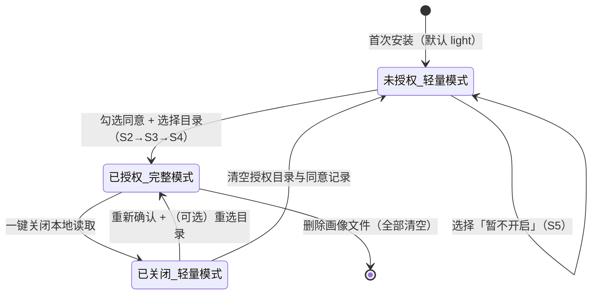

# 创意分身 Skill — 隐私政策与授权流程

> **产出部门**：E · 合规部
> **文档版本**：v1.0（授权告知文案版本号 `consent_version = "1.0"`）
> **生效日期**：2026-10-13
> **数据契约依据**：D · 画像部 `references/profile_schema.md`（`schema_version = 1`）、`assets/profile_template.json`
> **上位依据**：PRD 第七节「合规与隐私设计」、第五节模块 2「用户画像系统」、架构部 7.4「隐私合规落地清单」
> **配套交付**：README 隐私草稿（见本文件附录 B，另以 `references/readme_privacy_draft.md` 交付 G 部）

---

## 0. 一句话承诺（TL;DR）

1. **本 Skill 不收集你的任何数据**：没有账号、没有服务器、没有埋点、没有崩溃上报，全部代码开源可查。
2. **唯一涉及读取本地文件的功能默认关闭**，只有你主动勾选授权、并亲自选择文件夹之后才会开启；不授权完全不影响使用。
3. **从你的文件中只提取四类摘要特征**（写作风格、知识背景、关注领域、思考深度），不复制原文、不修改原文件；提取结果只存在你自己电脑上的画像文件里。
4. **你随时可以一键关闭、查看、编辑、删除全部数据**，关闭后自动退化为「问卷 + 对话」轻量模式，6 步流程照常运转。

> 模型运行环境的数据流说明（重要且诚实的补充）见 [第 2.3 节](#23-关于模型运行环境的诚实说明skill-之外的数据流)。

---

## 1. 政策适用范围与关键术语

### 1.1 适用范围

本政策适用于「创意分身」（creative-clone）Skill 仓库内的全部内容，包括但不限于：

- `SKILL.md` 及其编排的 6 步用户流程；
- `scripts/init_profile.py`、`scripts/update_profile.py`（画像初始化与更新脚本）；
- `references/` 下全部参考文档与三引擎 Prompt；
- `assets/profile_template.json` 与 `assets/scene_profiles/*.json` 场景配置。

不适用于：运行本 Skill 的宿主平台（如 WorkBuddy AI）及其模型供应商（如 GPT、Gemini、DeepSeek）自身的服务条款与隐私政策，也不适用于你设备上的其他软件。

### 1.2 关键术语

| 术语 | 含义 |
|------|------|
| **用户画像（Profile）** | 存储你跨场景思维模式、知识背景、兴趣倾向、审美判断的本地 JSON 文件，是 Skill 的「长期记忆」。 |
| **画像文件** | 默认路径 `~/.creative-clone/profile.json`，UTF-8 明文 JSON，由 D 部脚本创建和维护。 |
| **授权目录（authorized_dirs）** | 你通过系统文件夹选择器主动指定、允许 Skill 只读访问的一个或多个文件夹。 |
| **完整模式（full）** | 已授权状态：数据来源 = 本地文件读取 + 问卷 + 对话。 |
| **轻量模式（light）** | 未授权 / 已关闭状态：数据来源 = 仅问卷 + 对话。**首次安装后的默认模式。** |
| **摘要特征** | 从授权目录文档中提炼的结构化特征标签（写作风格、知识背景、关注领域、思考深度），**不是原文摘录**。 |
| **明示同意（explicit consent）** | 你在完整阅读告知文案后，通过主动勾选 + 点击确认作出的授权，不允许默认勾选、不允许跳过。 |
| **遥测（telemetry）** | 软件主动向开发者回传使用行为、设备信息、崩溃日志等数据的行为。本 Skill **零遥测**。 |

---

## 2. 数据处理总原则

### 2.1 五条总原则

| 编号 | 原则 | 落地方式 |
|------|------|---------|
| P1 | **本地优先（local-first）** | 画像文件、初始化、更新全部在你的设备上完成，Skill 不内置任何服务端地址、上传接口或统计 SDK。 |
| P2 | **零上传（zero upload）** | Skill 自身代码不发起任何指向开发者的数据回传；不收集 IP、设备指纹、剪贴板、位置、通讯录等信息。 |
| P3 | **无账号体系** | 画像中 `user_id` 恒为 `local-anon`，不要求注册、不要求邮箱、不生成可跨设备追踪的标识。 |
| P4 | **最小采集（data minimization）** | 只采集生成选题必需的字段；`history` 上限 500 条、`signals` 每类上限 50 条，超出自动删除最旧记录。 |
| P5 | **开源可审计（open & auditable）** | 所有数据处理逻辑以源码和 Prompt 形式公开，审计方法见 [第 8 节](#8-透明可审计如何验证本政策)。 |

### 2.2 法律定性：开发者不是你的「个人信息处理者」

按《中华人民共和国个人信息保护法》（PIPL）的逻辑，个人信息处理者须能够**决定**信息处理的目的、方式并**实际接收**数据。本 Skill 的数据流全部闭合在你的设备本地：

- 开发者不接收、不存储、不接触你的任何数据；
- Skill 不提供任何把数据发给开发者的通道；
- 你对授权范围、保留期限、删除时机拥有完全且唯一的决定权。

因此，就本 Skill 自身而言，开发者不构成你个人信息的处理者，**你本人是自己数据的唯一控制者**。这也是 [第 9 节「隐私自担声明」](#9-隐私自担声明与责任边界) 成立的根本前提。

### 2.3 关于模型运行环境的诚实说明（Skill 之外的数据流）

本 Skill 通过大模型完成对话与生成。当你在宿主平台（如 WorkBuddy AI）上使用它时，需要区分两条数据流：

1. **Skill 自身的数据流**：如本政策所述——零收集、零上传、全本地。
2. **模型推理通道的数据流**：你在对话中输入的问卷回答、对话内容，以及授权后本地生成的画像摘要（供三引擎读取），会作为 prompt 的一部分发送给**你所使用的模型服务**（GPT / Gemini / DeepSeek 等），该环节按宿主平台与模型供应商各自的隐私政策和服务条款处理，不受本 Skill 控制。

为避免误解，特别说明：

- **你本地文件的原文不会被读取进对话**；进入 prompt 的只是本地脚本提取出的摘要特征（如「写作风格：克制、偏好长句」）；
- 领域饱和扫描引擎的 WebSearch 仅发送由学科领域提炼的检索关键词，不发送画像内容；
- 若你希望实现**完全离线**，可将 Skill 挂载到本地部署的模型后端（数据契约与 Prompt 均为模型无关设计，见 D 部 Schema 第 13 节）；
- 首次使用弹窗中 PRD 指定的「所有数据只存在你本地，不会上传」一句，指的是 **Skill 本身不包含任何上传行为**；弹窗同时会展示本说明，确保你在授权前获得完整、无歧义的信息。

---

## 3. 数据清单：我们处理哪些数据（与 D 部 Schema 严格对齐）

> 本表是 E 部与 D 部对齐后的唯一数据口径，与 `profile_schema.md` 第 14 节逐项一致，不得增删。

### 3.1 数据处理明细表

| # | 数据类别 | 具体内容 / 对应字段 | 来源 | 处理目的 | 是否需要授权 | 存储位置 | 是否离开本机（Skill 自身） |
|---|---------|---------------------|------|---------|-------------|---------|---------------------------|
| 1 | **你主动提供的信息** | 场景化问卷的回答（`preferences`，`source=explicit`；部分写入 `base.backgrounds/interests/resources`） | 问卷（Step 2） | 确定当前场景的方向、约束与兴趣 | 否 | 画像文件 | 否 |
| 2 | | 对话式补充与追问内容（`history`、`signals`、部分 `preferences`） | 对话（Step 3） | 补全画像缺口、审美与判断标准 | 否 | 画像文件 | 否 |
| 3 | | 反馈标记：`like`（有意思）/ `dislike`（换一批）/ `redirect`（方向偏了）/ `select`（最终选中） | 反馈（Step 6） | 迭代生成、沉淀偏好 | 否 | 画像文件 | 否 |
| 4 | | 最终选中的选题（`signals.selected_topics`、`base.interests`、`preferences.key=selected_topic`） | 反馈（Step 6） | 跨场景兴趣沉淀 | 否 | 画像文件 | 否 |
| 5 | **授权后提取的摘要特征** | 写作风格 `base.writing_style`、思考深度 `base.thinking_depth`（`shallow/medium/deep`）、知识背景 `base.backgrounds`、关注领域 `base.interests` | 授权目录内的文档 / 笔记 / 代码（Step 3 本地读取） | 让选题匹配你的表达习惯与思维层级 | **是，必须明示同意** | 画像文件 | 否（仅本地提取与存储） |
| 6 | **技术元数据** | 授权目录路径 `privacy.authorized_dirs`、各时间戳（`consented_at`、`created_at`、`updated_at`、`history.timestamp`）、`schema_version`、`consent_version`、`last_reviewed_at` | 脚本运行时自动生成 | 维持画像运转、记录授权状态与审计痕迹 | 否 | 画像文件 | 否 |
| 7 | **统计计数** | `stats.total_sessions / like_count / dislike_count / redirect_count / select_count` | 反馈时自动计数 | 本地展示使用情况，不回传 | 否 | 画像文件 | 否 |

### 3.2 明确不收集、不处理的数据

以下数据本 Skill **在任何模式下都不收集**：

- 真实姓名、手机号、邮箱、身份证号、账号凭据等身份信息（无账号体系，`user_id` 恒为 `local-anon`）；
- **授权目录内任何文档的原文内容**——画像只存摘要特征，不做原文复制或全文累积；
- 授权目录之外的任何文件与目录（不扫描全盘）；
- 网络请求日志、浏览记录、IP 地址、设备指纹、地理位置、通讯录、相册、麦克风、摄像头、生物识别信息；
- 任何形式的使用行为遥测、崩溃上报、广告标识符。

### 3.3 数据保留期限

| 数据 | 保留策略 |
|------|---------|
| 问卷 / 对话 / 反馈记录（`history`） | 上限 **500 条**，超出自动删除最旧记录；你可随时清空 |
| 信号聚合（`signals` 各类） | 每类上限 **50 条**，只保留最近信号 |
| 授权后提取的摘要特征 | 与画像文件同生命周期；关闭授权后默认保留（见 [6.5](#65-关闭授权与降级体验)），你可手动删除 |
| 全部数据 | **删除画像文件即全部清空**，无任何云端副本 |

---

## 4. 数据存储与安全

### 4.1 存储位置与格式

| 项 | 说明 |
|----|------|
| 默认路径 | `~/.creative-clone/profile.json`（可通过 `init_profile.py --path` 自定义） |
| 格式 | UTF-8 编码、明文 JSON、字段 snake_case、`schema_version = 1` |
| 创建方式 | 首次使用由 `scripts/init_profile.py` 从 `assets/profile_template.json` 复制创建 |
| 更新方式 | 每次反馈后由 `scripts/update_profile.py` 增量更新 |
| 版本控制 | 画像文件属于你的私人数据，**必须写入 `.gitignore`**，不随仓库提交、不进公开仓库 |

### 4.2 写入安全

- 所有写回均采用「**临时文件 + 原子替换**」（先写 `profile.json.tmp`，完成后 `replace`），进程中断或断电不会产生写一半的损坏文件；
- `init_profile.py --force` 重新初始化前，旧画像自动备份为 `profile.json.bak`；
- MVP 为单机单进程设计，「读—改—原子写」顺序执行；未来如需多进程并发，再引入文件锁。

### 4.3 你侧的安全建议（本地数据由你掌控，也请你守护）

画像为明文 JSON 且本地读取能力本身意味着 Skill 进程可以打开你授权目录中的文件，请你：

- 只授权**确实需要被理解**的文件夹（如笔记、文稿目录），**不要授权整个用户主目录或包含敏感证件、财务资料的目录**；
- 利用好系统账户权限、磁盘加密（macOS FileVault）与锁屏；
- 若你通过录屏、截图、分享会话等方式向他人展示使用过程，注意自行遮蔽敏感内容；
- 在公用或他人设备上使用后，删除画像文件并关闭授权。

---

## 5. 你的权利及操作方式

对齐 PRD「用户可以随时查看 / 编辑 / 删除自己的画像」，并细化为七项可操作权利：

| 权利 | 说明 | 操作方式 |
|------|------|---------|
| **知情权** | 授权前完整获知：读什么、为什么读、存哪里、是否离开本机 | 首次使用弹窗（文案见附录 A），任何时候可在设置中重新查看 |
| **选择权** | 自主决定开启或不开启本地读取 | 弹窗中选择「暂不开启」或「开启并选择文件夹」，均不被歧视、不被反复打扰 |
| **访问权** | 随时查看画像全部内容 | 打开 `~/.creative-clone/profile.json`，或运行 `python3 scripts/init_profile.py` 查看路径 |
| **更正权** | 随时修改任何画像字段 | 用任意文本编辑器直接编辑该 JSON（注意保持 JSON 语法合法），改完保存即生效 |
| **删除权** | 删除单条记录或清空全部画像 | 手动编辑删除；或直接删除 `~/.creative-clone/profile.json` 清空全部（删除前请自行备份，不可恢复） |
| **撤回同意权** | 随时关闭本地读取，无需理由 | 设置中一键关闭（详见 [6.5](#65-关闭授权与降级体验)）；再次开启需重新确认 |
| **可携带权** | 数据自包含、无锁定 | 画像为标准 JSON，可自行复制、备份、迁移到其他设备或其他模型后端 |

---

## 6. 授权流程设计（本章为独立授权章节）

> 本章是本地读取功能的唯一交互与状态契约，对应 PRD 7.2「明示同意 / 最小权限 / 可随时关闭」与 D 部 Schema 第 11 节。
> **核心设计：授权状态由确定性 Python 脚本与状态机管理，LLM 只负责如实呈现告知文案与用户的选择，不持有、不推断、不代行任何授权决定。**

### 6.1 两种模式对照

| 维度 | 完整模式（full） | 轻量模式（light，默认） |
|------|------------------|------------------------|
| 进入条件 | 明示同意 + 主动选择授权目录 | 未授权、拒绝授权或关闭授权 |
| 数据来源 | 本地文件读取 + 问卷 + 对话 | 仅问卷 + 对话 |
| 画像丰富度 | 高（含写作风格 / 思考深度等） | 基础（场景偏好与反馈信号） |
| 6 步闭环 | 完整可用 | 完整可用，**流程与输出标准不降级** |
| 差异 | 三引擎可额外引用风格与思维深度特征 | 「懂你」的深度随使用次数逐步累积，速度稍慢 |

### 6.2 首次授权交互流程（Step by Step）

**触发时机**：流程进入 Step 3（对话式补充），且检测到 `privacy.local_reading_enabled == false` 且 `privacy.consented_at == null`（从未询问过）。

| 步骤 | 系统动作 | 用户动作 / 分支 |
|------|---------|----------------|
| **S1 呈现弹窗** | 展示授权告知弹窗（完整文案见附录 A），内容覆盖：会读什么、为什么读、读取范围、数据存哪、模型通道说明、风险与自担提示、关闭方式 | 阅读 |
| **S2 明示选择** | 弹窗**无默认勾选**，「开启并选择文件夹」按钮在用户**主动勾选「我已阅读并同意」复选框之前保持置灰**；同时提供等权重的「暂不开启」 | 二选一：<br>① 勾选并点击「开启并选择文件夹」→ 进入 S3<br>② 点击「暂不开启」→ 进入 S5 |
| **S3 选择目录** | 调用**操作系统原生文件夹选择器**（macOS 由系统授权面板完成），不展示任何预设路径、不替用户选择 | 主动选定一个或多个文件夹并确认；亦可在此步取消 → 视为「暂不开启」 |
| **S4 记录同意并切换** | 脚本写入 `privacy.authorized_dirs`、`privacy.consented_at`（当前 UTC ISO 8601）、`privacy.consent_version = "1.0"`、`privacy.local_reading_enabled = true`，并将 `profile_meta.mode` 置为 `full`；写入采用原子替换 | 无；进入完整模式，继续 Step 3 |
| **S5 保持轻量** | 不写入任何授权字段，`mode` 保持 `light`，直接继续问卷 + 对话流程；**本会话内不再弹窗**（仅在设置中保留入口） | 正常使用，无任何功能受限提示 |

**合规红线（三条，源自 PRD 7.3）**：

- 禁止默认开启、默认勾选、跳过告知；
- 禁止把授权按钮设计成唯一醒目选项，或用「限时」「功能将不可用」等措辞施压、诱导；
- 禁止在用户拒绝后于同一会话内反复弹窗。

### 6.3 授权状态机



状态字段与画像 `privacy` 对象一一对应：

| 状态 | `local_reading_enabled` | `authorized_dirs` | `consented_at` | `profile_meta.mode` |
|------|--------------------------|-------------------|----------------|---------------------|
| 未授权 · 轻量 | `false` | `[]` | `null` | `light` |
| 已授权 · 完整 | `true` | 用户选定路径 | 记录时间 | `full` |
| 已关闭 · 轻量 | `false` | **保留**（可清空） | 记录保留 | `light` |

### 6.4 最小权限的技术约束（读取行为边界）

授权开启后，本地读取严格遵守以下边界，任何一条都应在代码中可被验证：

1. **目录白名单**：只读取 `authorized_dirs` 列表内的文件，**绝不扫描全盘、绝不向上回溯父目录**；
2. **不跟随符号链接**：防止通过软链接间接访问授权目录之外的文件；
3. **不触碰隐藏与系统目录**：跳过隐藏文件、系统目录与应用包内容；
4. **只读不改**：不修改、不移动、不重命名、不删除任何原始文件；
5. **只取摘要，不留原文**：写入画像的只有四类摘要特征，画像中不出现文档原文段落；
6. **有界读取**：单次读取的文件数量与体量设上限，超限只取代表性样本并向用户说明。

### 6.5 关闭授权与降级体验

**关闭路径**：设置 → 隐私与授权 → 「本地文件读取」开关 → 确认关闭。

关闭时脚本执行：

1. 置 `privacy.local_reading_enabled = false`，`profile_meta.mode = light`；
2. `authorized_dirs` 与 `consented_at` **保留记录**（供审计与恢复），但不再发生任何读取行为；你可在设置中手动「清空授权记录」；
3. 已提取的摘要特征**默认保留在画像中**（它们是历史数据），设置中提供「同时删除已提取的风格 / 深度特征」选项；
4. 刷新 `profile_meta.updated_at`，原子写回。

**降级体验设计原则**：

- 6 步闭环一步不少，四要素输出标准一条不降；
- 不弹警告、不显示红色「未保护」状态、不反复劝说重新开启；
- 三引擎在轻量模式下仅依赖问卷与对话画像工作，并在选题匹配说明中如实引用已有的画像条目；
- 重新开启需重新走 S2 确认（若 `consent_version` 已升级则必须展示新版告知文案），目录可沿用或重选。

### 6.6 授权文案版本管理与重新授权

- 当前授权告知文案版本：`consent_version = "1.0"`，与本政策版本一致；
- 当读取范围、数据用途、存储方式或模型通道发生**实质性变化**时，版本号升级（如 `1.1` / `2.0`），并对所有已授权用户在下次使用时重新展示告知弹窗、重新取得明示同意；
- 文案措辞的非实质性修正不触发重新授权，但会在 CHANGELOG 公示；
- 你最近一次查看授权设置的时间记录在 `privacy.last_reviewed_at`。

### 6.7 跨模型授权一致性设计（学习 GPT / Gemini / DeepSeek 运行模式后的结论）

我们研究了三家主流模型在工具调用、结构化输出与权限控制上的运行模式，结论如下，并据此把授权设计成**模型无关**：

| 研究维度 | GPT（OpenAI 生态） | Gemini（Google 生态） | DeepSeek（OpenAI 兼容） | 本 Skill 的吸收方式 |
|---------|--------------------|-----------------------|------------------------|--------------------|
| 结构化输出 | `response_format=json_schema` 严格模式（`strict:true`） | `responseMimeType=application/json` + `responseSchema`（OpenAPI 子集） | `response_format=json_object`，新版支持 `json_schema` | 授权状态读写**不经过 LLM**，全部由 D 部 Python 脚本确定性完成，模型不参与状态判断 |
| 工具 / 函数调用 | 严格 schema、参数校验 | function calling 命名约定 | OpenAI 兼容 function calling | 「选择文件夹」走**操作系统原生选择器**，不设计为模型 function call，避免模型越权拿到路径 |
| 权限交互惯例 | 显式 opt-in、作用域（scope）最小化、可随时撤销 | Google 权限模型强调用途说明与运行时请求 | 兼容 OpenAI 权限交互范式 | 弹窗明示用途、目录级最小授权、设置中随时撤回，与三家惯例同时兼容 |
| 记忆 / 偏好机制 | Memory 条目可溯源、可展示、可删除 | 上下文 / 记忆由调用方控制 | 由调用方自行管理上下文 | 画像每条偏好带 `source / evidence / confidence`，授权状态独立成 `privacy` 对象 |

**授权环节 Prompt 契约（三家模型统一执行，可直接挂载）**：

```text
你是「创意分身」的授权引导员，只负责如实呈现与记录，不做任何授权决定。
规则：
1. 首次进入对话补充环节、且画像 privacy.local_reading_enabled 为 false、consented_at 为 null 时，
   逐字展示附录 A 的授权告知文案，不得删减、改写风险提示。
2. 不得替用户勾选、不得预选「开启」、不得使用诱导或施压措辞，不得把「暂不开启」描述为损失。
3. 用户未勾选「我已阅读并同意」前，不得引导进入文件夹选择。
4. 用户选择开启：引导其使用系统文件夹选择器，并把所选路径交给脚本写入
   privacy.authorized_dirs / consented_at / consent_version，置 local_reading_enabled=true。
5. 用户选择暂不开启或中途取消：保持 light 模式，继续正常流程，本会话不再提及授权。
6. 用户询问隐私问题：依据 privacy_policy.md 原文回答，不确定时如实说明，严禁编造。
7. 任何模式下，你都不得输出、猜测或转述授权目录中的文件原文。
```

### 6.8 拒绝授权后的体验

- 不做任何功能阉割、不输出劝说文案、不降低选题质量标准；
- 仅在设置中保留一个低调的「开启本地读取，让分身更懂你」入口；
- 轻量模式下，「懂你」通过问卷 + 反馈跨场景沉淀自然实现，只是不包含写作风格与思考深度的本地特征。

---

## 7. 未成年人保护

- 本 Skill 为通用效率工具，**不主动面向不满十四周岁的未成年人**，不包含任何面向未成年人的诱导性设计；
- 未成年人应在监护人知情、指导下使用，并**谨慎授权文件夹**；
- 监护人若发现未成年人在未经指导下授权了敏感目录，可直接按 [第 5 节](#5-你的权利及操作方式) 关闭授权并删除画像文件。

---

## 8. 透明可审计：如何验证本政策

本 Skill 开源，你无需相信任何承诺，可以自行验证：

| 验证目标 | 方法 |
|---------|------|
| 确认无上传 / 无遥测代码 | 全仓检索网络调用：`grep -r -E "requests\\.(post|get)\\|urllib\\|http://\\|https://\\|socket\\|telemetry\\|analytics" --include=\"*.py\" .`，预期无任何指向数据收集的调用（三引擎 WebSearch 除外，其仅检索公开关键词） |
| 确认读取范围受白名单约束 | 审阅 `scripts/` 与画像读取逻辑，确认路径校验发生在 `privacy.authorized_dirs` 之内、不跟随符号链接 |
| 确认画像只存本地 | 检查 `~/.creative-clone/profile.json` 内容；确认 `.gitignore` 包含画像路径，画像不会被提交 |
| 确认数据范围与本政策一致 | 对照本文件 [第 3 节](#3-数据清单我们处理哪些数据与-d-部-schema-严格对齐) 与 D 部 `profile_schema.md` 第 14 节 |
| 网络层面观察 | 可在系统防火墙 / 网络抓包工具中观察 Skill 运行期间的连接，预期除模型推理与 WebSearch 外无其他外发连接 |
| 审阅三引擎 Prompt | 见 `references/engine_saturation_scan.md`、`engine_cross_collision.md`、`engine_self_critique.md`，确认无「收集并回传用户信息」类指令 |

---

## 9. 隐私自担声明与责任边界

> 对应 PRD 7.2「隐私自担声明」与 7.3 可行性要求。该声明以「第 2.2 节开发者不处理你的数据」为成立基础，且已在授权前充分告知（S1 弹窗）、由你明示勾选确认（S2），不存在默认开启或角落条款。

### 9.1 你需要自行承担的部分

1. **授权范围的决定责任**：你授权哪些文件夹、其中包含何种内容，由你自行判断与负责；建议参照 [4.3 节](#43-你侧的安全建议本地数据由你掌控也请你守护)，不授权含敏感证件、财务、他人隐私资料的目录；
2. **本地设备与账号的安全责任**：设备系统安全、账户登录、文件共享、会话录屏截图等环节造成的暴露，由你自行负责；
3. **授权内容的合法性责任**：你保证授权读取的文件不侵犯他人权益、不违反法律法规及与第三方的约定；
4. **生成内容的使用责任**：选题由 AI 生成、仅供参考，你须自行核实其中的事实、数据、文献与伦理合规性（另见 [第 10 节](#10-ai-生成内容声明)）。

### 9.2 开发者责任边界

- 本 Skill 以「**现状（AS IS）**」提供，开发者不提供任何明示或默示的保证；
- 在适用法律允许的最大范围内，开发者不对因使用或无法使用本 Skill（包括你自行授权读取、自行分享数据、模型运行环境或第三方行为）导致的任何间接、附带或后果性损失承担责任；
- **本条不排除、不限制依法不得排除或限制的责任**，包括但不限于：开发者故意或重大过失造成的损失、法律强制性规定赋予你的权利。就本 Skill 的实际架构而言，开发者不接触你的数据，亦不存在向开发者泄露的通道；
- 模型运行环境（宿主平台及模型供应商）的责任，以其各自服务条款与隐私政策为准。

### 9.3 授权前风险告知清单（弹窗内完整呈现，不得折叠）

- 本地读取开启后，Skill 进程可在你授权的文件夹内打开文件（仅提取摘要、只读不改）；
- 画像为明文 JSON，任何能登录你账户的人理论上可读取该文件；
- 提供给模型的摘要特征会经模型推理通道处理（见 2.3）；
- 你可随时一键关闭、清空授权记录并删除画像。

---

## 10. AI 生成内容声明

- 本 Skill 输出的全部选题、角度、风险提示均为 **AI 生成内容，仅供参考**，不构成学术、法律、商业或投资建议；
- 三引擎中领域饱和扫描若无法取得实时检索证据，会**明确标注「未实时检索」，严禁编造文献、数据或检索结果**；
- 你在正式使用选题（论文提交、内容发布、商业决策等）前，须自行核实事实、遵守学术规范、平台规则与相关法律法规，并按适用场景标注 AI 参与情况。

---

## 11. 政策变更与联系

### 11.1 变更机制

- 本政策采用版本号管理，当前 v1.0；
- 非实质性修订（措辞、格式）在 CHANGELOG 公示；
- 实质性变更（数据范围、用途、授权流程、模型通道）升版本号，并在 README 显著位置公示；已授权用户将被重新征求明示同意（见 6.6）。

### 11.2 问题反馈

如对本政策有疑问、发现实现与政策不一致，或对授权流程有改进建议，可通过 GitHub 仓库的 Issues 提交（**请勿在 Issue 中粘贴你的画像原文或任何敏感内容**）。

---

## 12. 合规对照清单（验收用）

### 12.1 PRD 7.2 设计点对照

| PRD 设计点 | 要求 | 本政策落地章节 |
|-----------|------|---------------|
| 明示同意 | 首次使用弹窗，通俗语言说明读什么、为什么读、存哪、不上传 | 0、6.2、附录 A |
| 最小权限 | 只读主动指定文件夹，不扫描全盘 | 6.4、3.2、4.3 |
| 可随时关闭 | 设置一键关闭，关闭后仅用问卷 + 对话 | 6.5、6.1 |
| 透明可审计 | 开源，处理逻辑公开，用户可自审 | 8、2.1 |
| 隐私自担声明 | 授权内容用户自担，开发者不承担泄露责任 | 9、2.2 |

### 12.2 PRD 7.3 可行性要求对照

| 要求 | 落地章节 |
|------|---------|
| 授权前充分告知风险，不藏在角落 | 6.2（S1）、9.3 |
| 明确勾选确认，不默认开启 | 6.2（S2）、6.5 |
| 代码开源、逻辑完全透明 | 8 |
| 画像明文 JSON，随时查看 / 删除 | 4.1、5 |
| README 最显眼位置放隐私政策 | 附录 B（交付 G 部，置于 README 首屏） |

### 12.3 E 部验收标准对照

| 验收标准 | 自查结论 |
|---------|---------|
| 覆盖 PRD 第七节所有设计点 | 见 12.1，五项全覆盖 |
| 授权流程可操作、交互步骤清晰 | 见 6.2（S1–S5）、6.3 状态机 |
| 符合开源项目合规要求（不收集数据、代码透明） | 见 2、8 |
| README 隐私章节通俗，非技术用户能懂 | 见附录 B |
| 与 D 部 Schema 数据范围一致 | 见第 3 节与 D 部第 14 节逐项对齐 |
| 架构 7.4 补充项：AI 生成内容标注 | 见第 10 节 |

---

## 附录 A：首次授权弹窗完整文案（可直接实现）

> 呈现要求：进入 Step 3 且未授权时弹出；文案完整展示，风险告知清单不得折叠；复选框默认未勾选，未勾选时主按钮置灰。

```text
┌──────────────────────────────────────────────┐
│  让「创意分身」更懂你 —— 本地读取授权说明      │
├──────────────────────────────────────────────┤
│ 我会做什么：                                   │
│ 读取你【亲自选择的文件夹】里的文档、笔记或代码， │
│ 从中了解你的写作风格、知识背景、关注领域和思考   │
│ 深度，让给出的选题更贴合你的思路。               │
│                                                │
│ 我不会做什么：                                 │
│ · 不扫描你的整个磁盘，只访问你指定的文件夹；     │
│ · 不复制、不保存你的文档原文，只提取摘要特征；   │
│ · 不修改、不移动、不删除你的任何文件；          │
│ · 创意分身本身没有服务器，不会上传任何数据。     │
│                                                │
│ 数据存在哪里：                                 │
│ 全部以 JSON 形式存在你本机：                    │
│ ~/.creative-clone/profile.json                 │
│                                                │
│ 需要你知道的两点：                             │
│ 1. 生成选题时，本地提取的摘要特征会作为对话内容  │
│    发送给你正在使用的模型服务，其按自身隐私政策  │
│    处理；文件原文不会进入对话。                 │
│ 2. 画像为明文文件，请只授权不含敏感证件、财务    │
│    资料的文件夹。                              │
│                                                │
│ 你随时可以：在设置中一键关闭、清空授权记录、查看 │
│ 或删除画像文件；关闭后仍可正常使用问卷 + 对话。  │
│                                                │
│ ☐ 我已阅读并同意《隐私政策》，了解上述内容与风险 │
│                                                │
│  [暂不开启]            [开启并选择文件夹]       │
│                  （未勾选时此按钮置灰）          │
└──────────────────────────────────────────────┘
```

**授权记录写入示例（`privacy` 对象，授权后）**：

```json
{
  "local_reading_enabled": true,
  "authorized_dirs": ["/Users/yourname/Documents/notes"],
  "consented_at": "2026-10-13T08:00:00+00:00",
  "consent_version": "1.0",
  "last_reviewed_at": null
}
```

---

## 附录 B：README 隐私草稿

> 本附录为交付 G 部的 Markdown 片段，已另存为 `references/readme_privacy_draft.md`；
> G 部应将其置于 README 首屏（项目简介之后、安装说明之前），这是 PRD 7.3 的硬性要求。

### 🔒 隐私安全：先说最重要的事

**创意分身不收集你的任何数据。**

- **没有账号、没有服务器、没有埋点**：所有数据处理逻辑开源，你可以逐行审查。
- **读你文件这件事，默认关闭**：只有你主动勾选授权、并亲自选择文件夹后才会开启；不授权，全部功能照样能用。
- **只读你指定的文件夹，不扫全盘**：只提取「写作风格、知识背景、关注领域、思考深度」四类摘要特征，不复制原文、不改动你的文件；结果只存在你本机 `~/.creative-clone/profile.json`。
- **随时可以反悔**：设置里一键关闭即退回「问卷 + 对话」模式；画像可随时查看、编辑、删除。

> 小提示：通过云端模型生成选题时，对话内容（含本地提取的摘要）会按该模型服务的隐私政策处理；文件原文不会进入对话。想完全离线，可挂载本地模型。

| 数据 | 存哪 | 是否上传 |
|------|------|----------|
| 问卷回答、对话、反馈、选中的选题 | 你的本机画像文件 | 否 |
| 授权后提取的摘要特征 | 你的本机画像文件 | 否 |
| 文档原文 | 不提取、不保存 | 否 |

👉 完整说明见 [隐私政策](references/privacy_policy.md)。

---

## 附录 C：SKILL.md「授权与隐私」章节整合建议

> 供上司整合阶段替换 `SKILL.md` 中 `<!-- TODO: E 部门完成后，补充授权流程交互细节 -->` 一处。建议替换为：

```markdown
- **默认轻量模式，本地读取默认关闭**：首次使用无需授权即可走完 6 步流程；
- **授权两步走**：Step 3 弹出告知弹窗 → 用户主动勾选「我已阅读并同意」→ 系统文件夹选择器中亲自指定目录；无默认勾选、无诱导；
- **最小权限**：只读授权目录、不跟随符号链接、不扫全盘、只提取四类摘要特征、不改原文件；
- **随时撤回**：设置中一键关闭即降级为轻量模式，流程与输出标准不降级；
- 授权交互细则、状态机、弹窗文案、跨模型授权 Prompt 契约见 `references/privacy_policy.md` 第 6 节与附录 A。
```

---

*本文件由 E · 合规部产出。如实现代码与本政策存在任何不一致，以「先修正代码或先修正政策、二者必须一致」为原则处理，并在整合前提出。*
