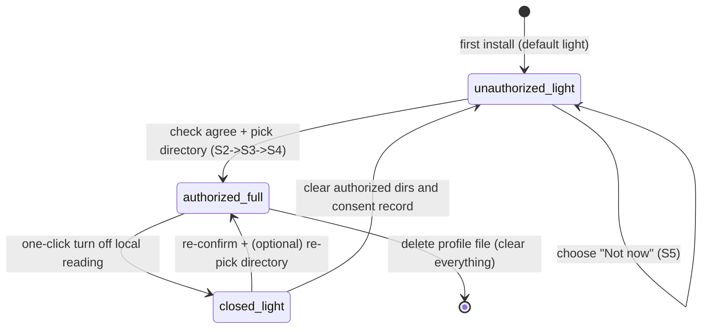

# Creative Avatar Skill: Privacy Policy and Consent Flow

> **Produced by**: Team E (Compliance)
> **Document version**: v1.0 (consent notice version `consent_version = "1.0"`)
> **Effective date**: 2026-10-13
> **Data contract basis**: Team D's `references/profile_schema.md` (`schema_version = 1`) and `assets/profile_template.json`
> **Upstream references**: PRD section 7 "Compliance and privacy design", section 5 module 2 "User profile system", architecture team section 7.4 "Privacy compliance checklist"
> **Related deliverable**: README privacy draft (see Appendix B; also delivered to Team G as `references/readme_privacy_draft.md`)

---

## 0. TL;DR

1. **This Skill does not collect any of your data**: no account, no server, no tracking events, no crash reporting. All code is open source and readable line by line.
2. **The only feature that reads local files is off by default**. It turns on only after you explicitly grant consent and pick a folder yourself. Without consent, every feature still works.
3. **It extracts only four kinds of summary features** from your files (writing style, knowledge background, interests, depth of thinking). It does not copy the original text and does not modify your files. The extracted results are stored only in your local profile file on your own machine.
4. **You can turn everything off, view it, edit it, or delete it in one click at any time**. Once off, the Skill falls back to questionnaire + dialogue mode, and the 6-step flow keeps working.

> For the data-flow note on the model runtime (an important, honest supplement), see [section 2.3](#23-honest-note-on-the-model-runtime-data-flow-outside-the-skill).

---

## 1. Scope and key terms

### 1.1 Scope

This policy applies to everything in the Creative Avatar (`creative-clone`) Skill repository, including:

- `SKILL.md` and the 6-step user flow it orchestrates;
- `scripts/init_profile.py` and `scripts/update_profile.py` (profile init and update scripts);
- All reference docs and the three engine prompts under `references/`;
- `assets/profile_template.json` and the scene profiles in `assets/scene_profiles/*.json`.

It does not apply to the host platform that runs this Skill (such as WorkBuddy AI) or its model providers (such as GPT, Gemini, DeepSeek), whose own terms of service and privacy policies apply. It also does not apply to other software on your device.

### 1.2 Key terms

| Term | Meaning |
|------|---------|
| **User profile** | A local JSON file that stores your cross-scenario thinking patterns, knowledge background, interest tendencies, and aesthetic judgments. It is the Skill's long-term memory. |
| **Profile file** | Default path `~/.creative-clone/profile.json`, plain UTF-8 JSON, created and maintained by Team D's scripts. |
| **Authorized directories (`authorized_dirs`)** | One or more folders you explicitly pick with the system folder picker, which the Skill may read only. |
| **Full mode (`full`)** | Consent granted: data sources = local file reading + questionnaire + dialogue. |
| **Light mode (`light`)** | No consent, or consent revoked: data sources = questionnaire + dialogue only. **This is the default mode after install.** |
| **Summary features** | Structured feature tags extracted from documents in the authorized directories (writing style, knowledge background, interests, depth of thinking). **They are not excerpts of the original text.** |
| **Explicit consent** | After reading the notice in full, you grant access by checking a box and confirming. Pre-checked boxes and skipped notices are not allowed. |
| **Telemetry** | When software sends usage behavior, device info, or crash logs back to its developer. This Skill has **zero telemetry**. |

---

## 2. Core data-processing principles

### 2.1 Five principles

| # | Principle | How it is implemented |
|---|-----------|-----------------------|
| P1 | **Local-first** | The profile file, initialization, and updates all happen on your device. The Skill contains no server addresses, upload endpoints, or analytics SDK. |
| P2 | **Zero upload** | The Skill's own code sends nothing back to the developer. It does not collect IP addresses, device fingerprints, clipboard contents, location, or contacts. |
| P3 | **No account system** | `user_id` in the profile is always `local-anon`. No registration, no email, no cross-device tracking identifier. |
| P4 | **Data minimization** | Only the fields needed to generate topic ideas are stored. `history` is capped at 500 entries and `signals` at 50 entries per category; older entries are deleted automatically. |
| P5 | **Open and auditable** | All data-processing logic is public as source code and prompts. See [section 8](#8-transparency-and-audit-how-to-verify-this-policy) for how to audit. |

### 2.2 Legal framing: the developer is not your personal-information processor

Under the PIPL (Personal Information Protection Law of the People's Republic of China), a personal-information processor must be able to **decide** the purpose and means of processing and must **actually receive** the data. In this Skill, the data flow stays entirely on your device:

- The developer does not receive, store, or touch any of your data;
- The Skill provides no channel to send data to the developer;
- You have full and sole control over the scope of consent, retention period, and deletion.

Therefore, for this Skill itself, the developer is not a processor of your personal information. **You are the sole controller of your own data.** This is the basis on which [section 9, the assumed-privacy notice](#9-assumed-privacy-notice-and-liability-boundary), rests.

### 2.3 Honest note on the model runtime (data flow outside the Skill)

This Skill uses a large language model to run dialogue and generation. When you use it on a host platform (such as WorkBuddy AI), two data flows must be kept separate:

1. **The Skill's own data flow**: as described in this policy: zero collection, zero upload, all local.
2. **The model inference channel**: your questionnaire answers, dialogue content, and the locally generated profile summary after consent (read by the three engines) are sent as part of the prompt to **the model service you are using** (GPT / Gemini / DeepSeek, etc.). That channel is governed by the host platform's and model provider's own privacy policies and terms, and is outside this Skill's control.

To avoid misunderstanding:

- **The original text of your local files is not read into the conversation**. What enters the prompt is only the summary features extracted by the local scripts (e.g., "writing style: restrained, prefers long sentences");
- The saturation scan engine's WebSearch sends only search keywords derived from a discipline, not profile content;
- If you want to run **fully offline**, you can point the Skill at a locally deployed model backend (the data contract and prompts are model-agnostic; see section 13 of Team D's schema);
- The PRD-mandated line in the first-run popup, "all data stays on your device and is never uploaded", means **the Skill itself contains no upload behavior**. The popup also shows this note, so you have complete, unambiguous information before consenting.

---

## 3. Data inventory: what data we process (strictly aligned with team D's schema)

> This table is the single agreed data definition between Team E and Team D. It matches section 14 of `profile_schema.md` line by line; do not add or remove rows.

### 3.1 Data-processing detail

| # | Data category | Specific content / corresponding fields | Source | Purpose | Consent needed? | Stored where | Leaves this machine (the Skill itself)? |
|---|---------------|----------------------------------------|--------|---------|-----------------|--------------|------------------------------------------|
| 1 | **Information you provide** | Scenario questionnaire answers (`preferences`, `source=explicit`; some written to `base.backgrounds/interests/resources`) | Questionnaire (Step 2) | Set the direction, constraints, and interests for the current scenario | No | Profile file | No |
| 2 | | Follow-up dialogue and follow-up questions (`history`, `signals`, some `preferences`) | Dialogue (Step 3) | Fill profile gaps, record aesthetic and judgment criteria | No | Profile file | No |
| 3 | | Feedback marks: `like` (interesting) / `dislike` (show another batch) / `redirect` (wrong direction) / `select` (final pick) | Feedback (Step 6) | Iterate generation, accumulate preferences | No | Profile file | No |
| 4 | | Finally selected topic ideas (`signals.selected_topics`, `base.interests`, `preferences.key=selected_topic`) | Feedback (Step 6) | Accumulate cross-scenario interests | No | Profile file | No |
| 5 | **Summary features extracted after consent** | Writing style `base.writing_style`, thinking depth `base.thinking_depth` (`shallow/medium/deep`), knowledge background `base.backgrounds`, interests `base.interests` | Documents / notes / code in authorized directories (local read at Step 3) | Match topic ideas to your expression habits and depth of thinking | **Yes, explicit consent required** | Profile file | No (extracted and stored locally only) |
| 6 | **Technical metadata** | Authorized directory paths `privacy.authorized_dirs`, timestamps (`consented_at`, `created_at`, `updated_at`, `history.timestamp`), `schema_version`, `consent_version`, `last_reviewed_at` | Generated automatically when scripts run | Keep the profile running, record consent state and audit trail | No | Profile file | No |
| 7 | **Stat counters** | `stats.total_sessions / like_count / dislike_count / redirect_count / select_count` | Counted automatically on feedback | Show local usage stats; not sent anywhere | No | Profile file | No |

### 3.2 Data we explicitly do not collect or process

This Skill **does not collect the following in any mode**:

- Identity information such as real name, phone number, email, national ID, or account credentials (there is no account system; `user_id` is always `local-anon`);
- **The original text of any document inside authorized directories** — the profile stores summary features only, with no original-text copying or accumulation;
- Any file or directory outside the authorized directories (it does not scan the whole disk);
- Network request logs, browsing history, IP addresses, device fingerprints, geolocation, contacts, photo library, microphone, camera, or biometric data;
- Usage telemetry, crash reports, or advertising identifiers of any kind.

### 3.3 Retention period

| Data | Retention policy |
|------|------------------|
| Questionnaire / dialogue / feedback records (`history`) | Capped at **500 entries**; older entries deleted automatically. You can clear them at any time. |
| Aggregated signals (`signals`, each category) | Capped at **50 entries per category**; only the most recent signals are kept. |
| Summary features extracted after consent | Same lifecycle as the profile file. Kept by default after consent is revoked (see [6.5](#65-revoking-consent-and-the-degraded-experience)); you can delete them manually. |
| All data | **Deleting the profile file clears everything**. There is no cloud copy. |

---

## 4. Storage and security

### 4.1 Location and format

| Item | Description |
|------|-------------|
| Default path | `~/.creative-clone/profile.json` (customizable with `init_profile.py --path`) |
| Format | UTF-8, plain JSON, snake_case fields, `schema_version = 1` |
| Created | On first use, copied from `assets/profile_template.json` by `scripts/init_profile.py` |
| Updated | After each feedback event, incrementally by `scripts/update_profile.py` |
| Version control | The profile file is your private data and **must be in `.gitignore`**. It is never committed to or published in the repository. |

### 4.2 Write safety

- All writes use a **temp file + atomic replace** (write to `profile.json.tmp`, then `replace` it). An interrupted process or power loss cannot leave a half-written corrupted file.
- Before `init_profile.py --force` re-initializes, the old profile is backed up to `profile.json.bak`.
- The MVP is designed for a single machine, single process: read-modify-atomic-write runs in order. File locks can be added later if multi-process concurrency is needed.

### 4.3 Your side: security recommendations (your local data is yours to control and protect)

The profile is plain JSON, and local file reading means the Skill process can open files in your authorized directories. Please:

- Grant access only to folders you **actually want it to understand** (such as notes or writing folders). **Do not authorize your entire home directory or folders containing sensitive ID documents, financial records, or other people's data.**
- Use your system account permissions, full-disk encryption (macOS FileVault), and a screen lock.
- If you show your screen to others via screen recording, screenshots, or shared sessions, mask sensitive content yourself.
- After using a shared or someone else's device, delete the profile file and revoke consent.

---

## 5. Your rights and how to exercise them

Aligned with the PRD ("users can view / edit / delete their own profile at any time"), broken down into seven actionable rights:

| Right | Description | How to exercise it |
|-------|-------------|--------------------|
| **Right to be informed** | Before consent, you fully know what is read, why, where it is stored, and whether it leaves this machine | First-run popup (full text in Appendix A); viewable again in Settings at any time |
| **Right to choose** | You decide whether to turn on local reading | In the popup, choose "Not now" or "Turn on and pick a folder". Neither choice is penalized, and neither leads to repeated prompts. |
| **Right of access** | View the full profile at any time | Open `~/.creative-clone/profile.json`, or run `python3 scripts/init_profile.py` to see the path |
| **Right to correct** | Edit any profile field at any time | Edit the JSON directly in any text editor (keep it valid JSON); saving takes effect immediately |
| **Right to erasure** | Delete a single record or clear the whole profile | Edit and delete manually, or delete `~/.creative-clone/profile.json` to clear everything (back up first; deletion cannot be undone) |
| **Right to withdraw consent** | Turn off local reading at any time, for any reason | One-click off in Settings (see [6.5](#65-revoking-consent-and-the-degraded-experience)). Turning it back on requires re-confirmation. |
| **Right to data portability** | The data is self-contained and not locked in | The profile is standard JSON; you can copy, back up, and move it to another device or another model backend. |

---

## 6. Consent flow design (this chapter is a standalone consent contract)

> This chapter is the sole interaction and state contract for local file reading. It corresponds to PRD 7.2 ("explicit consent / least privilege / revocable at any time") and section 11 of Team D's schema.
> **Core design: consent state is managed by deterministic Python scripts and a state machine. The LLM only presents the notice and the user's choices faithfully; it holds no consent state, infers no consent, and makes no consent decisions on the user's behalf.**

### 6.1 Full vs light mode

| Dimension | Full mode (`full`) | Light mode (`light`, default) |
|-----------|--------------------|-------------------------------|
| Entry condition | Explicit consent + user picks authorized directories | No consent, consent refused, or consent revoked |
| Data sources | Local file reading + questionnaire + dialogue | Questionnaire + dialogue only |
| Profile richness | High (includes writing style / thinking depth, etc.) | Basic (scenario preferences and feedback signals) |
| 6-step loop | Fully usable | Fully usable; **the flow and output standards do not degrade** |
| Difference | The three engines can also reference style and thinking-depth features | The profile accumulates gradually with use; slightly slower to build up |

### 6.2 First-run consent interaction, step by step

**Trigger**: the flow reaches Step 3 (follow-up dialogue) and detects `privacy.local_reading_enabled == false` and `privacy.consented_at == null` (never asked before).

| Step | System action | User action / branch |
|------|---------------|----------------------|
| **S1 Show popup** | Show the consent notice popup (full text in Appendix A), covering: what it reads, why, the read scope, where data is stored, the model-channel note, risks and assumed-liability notice, and how to turn it off | Read it |
| **S2 Explicit choice** | The popup has **no pre-checked box**. The "Turn on and pick a folder" button **stays grayed out until the user checks the "I have read and agree" checkbox**. An equally weighted "Not now" option is also offered | Choose one:<br>① Check the box and click "Turn on and pick a folder" → go to S3<br>② Click "Not now" → go to S5 |
| **S3 Pick directory** | Call the **operating system's native folder picker** (on macOS, this is done by the system authorization panel). No preset paths are shown; the user is not steered | The user picks one or more folders and confirms. Canceling at this step counts as "Not now". |
| **S4 Record consent and switch** | The script writes `privacy.authorized_dirs`, `privacy.consented_at` (current UTC ISO 8601), `privacy.consent_version = "1.0"`, `privacy.local_reading_enabled = true`, and sets `profile_meta.mode` to `full`. Writes use atomic replace. | None; enters full mode and continues Step 3 |
| **S5 Stay in light mode** | No consent fields are written; `mode` stays `light`; the flow continues with questionnaire + dialogue. **No more popups this session** (an entry point remains in Settings). | Normal use; no feature-limit warnings |

**Compliance red lines (three, from PRD 7.3)**:

- No default-on, no pre-checked box, no skipped notice;
- No designing the consent button as the only prominent option, and no pressuring or nudging with wording like "limited time" or "feature will stop working";
- No repeated popups in the same session after the user refuses.

### 6.3 Consent state machine



The state fields map one-to-one to the profile's `privacy` object:

| State | `local_reading_enabled` | `authorized_dirs` | `consented_at` | `profile_meta.mode` |
|-------|--------------------------|-------------------|----------------|---------------------|
| Unauthorized · light | `false` | `[]` | `null` | `light` |
| Authorized · full | `true` | User-picked paths | Timestamp recorded | `full` |
| Closed · light | `false` | **Kept** (can be cleared) | Record kept | `light` |

### 6.4 Least-privilege technical constraints (read behavior boundaries)

After consent, local reading strictly follows these boundaries, each verifiable in code:

1. **Directory whitelist**: reads only files inside `authorized_dirs`. **It never scans the whole disk and never walks up to parent directories.**
2. **No symlink following**: prevents reaching files outside authorized directories through symlinks.
3. **No hidden or system directories**: skips hidden files, system directories, and application bundle contents.
4. **Read-only**: does not modify, move, rename, or delete any original file.
5. **Summary only, no original text**: only the four summary-feature categories are written to the profile; no document paragraphs appear in it.
6. **Bounded reading**: single-read file count and size are capped. Beyond the cap, only a representative sample is taken, and the user is told.

### 6.5 Revoking consent and the degraded experience

**How to turn off**: Settings → Privacy & Authorization → toggle "Local file reading" → confirm.

On turn-off, the script:

1. Sets `privacy.local_reading_enabled = false` and `profile_meta.mode = light`;
2. **Keeps** `authorized_dirs` and `consented_at` (for audit and recovery), but no reading happens anymore. The user can manually "clear consent records" in Settings;
3. **Keeps the extracted summary features in the profile by default** (they are historical data). Settings offers an option to "also delete extracted style / depth features";
4. Refreshes `profile_meta.updated_at` and writes back atomically.

**Degraded-experience principles**:

- The 6-step loop loses no steps, and the four-element output standard does not drop;
- No warning popups, no red "unprotected" status, no repeated persuasion to turn it back on;
- In light mode, the three engines work from the questionnaire + dialogue profile and cite existing profile entries honestly when explaining topic matches;
- Turning back on requires re-confirmation through S2 (if `consent_version` has been upgraded, the new notice must be shown). The directory can be kept or re-picked.

### 6.6 Consent text versioning and re-consent

- Current consent notice version: `consent_version = "1.0"`, matching this policy's version;
- When the read scope, data use, storage, or model channel change **materially**, the version number is bumped (e.g., `1.1` / `2.0`), and all consenting users see the notice again and must re-grant explicit consent on next use;
- Non-substantive wording fixes do not trigger re-consent but are listed in the CHANGELOG;
- The last time you viewed consent settings is recorded in `privacy.last_reviewed_at`.

### 6.7 Cross-model consistency (conclusions from studying GPT / Gemini / DeepSeek runtimes)

We studied how three major models handle tool calls, structured output, and permissions, and designed consent to be **model-agnostic**:

| Dimension | GPT (OpenAI ecosystem) | Gemini (Google ecosystem) | DeepSeek (OpenAI-compatible) | How this Skill adopts it |
|-----------|------------------------|---------------------------|------------------------------|---------------------------|
| Structured output | `response_format=json_schema` strict mode (`strict:true`) | `responseMimeType=application/json` + `responseSchema` (OpenAPI subset) | `response_format=json_object`; newer versions support `json_schema` | Consent state reads/writes **do not go through the LLM**. They are done deterministically by Team D's Python scripts; the model takes no part in state decisions. |
| Tool / function calling | Strict schemas, parameter validation | Function-calling naming conventions | OpenAI-compatible function calling | "Pick a folder" uses the **OS native picker**, not a model function call, so the model cannot overreach and obtain paths. |
| Permission conventions | Explicit opt-in, minimized scopes, revocable at any time | Google's permission model emphasizes purpose statements and runtime requests | OpenAI-compatible permission interaction | The popup states the purpose explicitly, grants directory-level least privilege, and is revocable in Settings, matching all three conventions. |
| Memory / preferences | Memory entries are traceable, displayable, and deletable | Context / memory controlled by the caller | Caller manages its own context | Each preference carries `source / evidence / confidence`; consent state lives in its own `privacy` object. |

**Consent-stage prompt contract (same for all three models; ready to mount)**:

```text
You are the consent guide for Creative Avatar. You only present and record faithfully; you make no consent decisions.
Rules:
1. When the user first enters the follow-up dialogue, and the profile has privacy.local_reading_enabled = false
   and consented_at = null, show the Appendix A consent notice verbatim. Do not shorten or rewrite the risk notice.
2. Do not check the box for the user, do not preselect "turn on", do not use nudging or pressuring wording,
   and do not describe "Not now" as a loss.
3. Until the user checks "I have read and agree", do not steer them into the folder picker.
4. If the user turns it on: guide them to the system folder picker and hand the chosen paths to the script
   to write privacy.authorized_dirs / consented_at / consent_version and set local_reading_enabled = true.
5. If the user chooses "Not now" or cancels midway: stay in light mode, continue the normal flow,
   and do not mention consent again this session.
6. If the user asks privacy questions, answer from privacy_policy.md verbatim. If unsure, say so. Never invent.
7. In any mode, do not output, guess, or paraphrase the original text of files inside authorized directories.
```

### 6.8 Experience after refusing consent

- No feature is cut, no persuasion text is shown, and topic-quality standards are not lowered;
- Settings keeps one low-key entry: "Turn on local reading to let the profile fit you better";
- In light mode, the profile is built naturally across scenarios through questionnaire + feedback; it simply does not include local writing-style and thinking-depth features.

---

## 7. Minor protection

- This Skill is a general productivity tool. It does **not target users under 14**, and contains no design meant to draw in minors;
- Minors should use it with a guardian's knowledge and guidance, and **grant folder access cautiously**;
- If a guardian finds that a minor has authorized sensitive directories without guidance, they can turn off consent and delete the profile file directly under [section 5](#5-your-rights-and-how-to-exercise-them).

---

## 8. Transparency and audit: how to verify this policy

This Skill is open source. You do not have to trust any promises; you can verify them yourself:

| Verification goal | Method |
|-------------------|--------|
| Confirm no upload / no telemetry code | Search the whole repo for network calls: `grep -r -E "requests\\.(post|get)\\|urllib\\|http://\\|https://\\|socket\\|telemetry\\|analytics" --include=\\"*.py\\" .` Expected: no calls that collect data (except the three engines' WebSearch, which only queries public keywords) |
| Confirm the read scope is whitelisted | Review `scripts/` and the profile-reading logic; confirm path checks stay inside `privacy.authorized_dirs` and that symlinks are not followed |
| Confirm the profile stays local | Inspect `~/.creative-clone/profile.json`; confirm `.gitignore` includes the profile path so it is never committed |
| Confirm data scope matches this policy | Cross-check [section 3](#3-data-inventory-what-data-we-process-strictly-aligned-with-team-ds-schema) here against section 14 of Team D's `profile_schema.md` |
| Observe at the network layer | Watch connections while the Skill runs, using a system firewall or network capture tool. Expected: no outbound connections other than model inference and WebSearch. |
| Review the three engine prompts | See `references/engine_saturation_scan.md`, `engine_cross_collision.md`, `engine_self_critique.md`; confirm there is no instruction to "collect and send user information back". |

---

## 9. Assumed-privacy notice and liability boundary

> Corresponds to PRD 7.2 "assumed-privacy notice" and the 7.3 feasibility requirements. This notice is based on the fact that the developer does not process your data (section 2.2). It is fully disclosed before consent (S1 popup) and explicitly confirmed by you (S2). There is no default-on and no buried clause.

### 9.1 What you assume responsibility for

1. **Scope of consent**: which folders you authorize and what they contain is your own judgment and responsibility. Follow [section 4.3](#43-your-side-security-recommendations-your-local-data-is-yours-to-control-and-protect); do not authorize directories containing sensitive ID documents, financial records, or other people's private data;
2. **Local device and account security**: exposure caused by device system security, account login, file sharing, session recording, or screenshots is your own responsibility;
3. **Legality of what you authorize**: you warrant that the files you authorize for reading do not infringe others' rights and do not violate laws or third-party agreements;
4. **Use of generated content**: topic ideas are AI-generated and for reference only. You must verify the facts, data, citations, and ethics yourself (also see [section 10](#10-ai-generated-content-notice)).

### 9.2 Developer liability boundary

- This Skill is provided **"AS IS"**. The developer gives no express or implied warranty.
- To the maximum extent permitted by applicable law, the developer is not liable for any indirect, incidental, or consequential loss arising from use of, or inability to use, this Skill (including folders you authorize yourself, data you share yourself, the model runtime environment, or third-party conduct).
- **This does not exclude or limit liability that cannot be excluded or limited by law**, including but not limited to loss caused by the developer's willful misconduct or gross negligence, and rights granted to you by mandatory law. Given the Skill's actual architecture, the developer never touches your data, and no channel to leak data to the developer exists.
- Liability for the model runtime environment (host platform and model providers) follows their respective terms of service and privacy policies.

### 9.3 Risk-disclosure checklist before consent (shown in full in the popup; no collapsing)

- Once local reading is on, the Skill process can open files in your authorized folders (summary extraction only, read-only);
- The profile is plain JSON. Anyone who can log into your account can theoretically read it;
- The summary features sent to the model pass through the model inference channel (see 2.3);
- You can turn it off, clear consent records, and delete the profile at any time.

---

## 10. AI-generated content notice

- All topic ideas, angles, and risk notes output by this Skill are **AI-generated content for reference only**. They are not academic, legal, business, or investment advice.
- If the saturation scan engine cannot get real-time search evidence, it **explicitly marks the result as "not searched in real time"**. It must not invent citations, data, or search results.
- Before you use a topic idea for real (paper submission, content publishing, business decisions), verify the facts yourself, follow academic norms, platform rules, and applicable laws, and disclose AI involvement as required by the scenario.

---

## 11. Policy changes and contact

### 11.1 Change mechanism

- This policy uses version numbers; current version v1.0;
- Non-substantive edits (wording, formatting) are listed in the CHANGELOG;
- Substantive changes (data scope, purpose, consent flow, model channel) bump the version and are posted prominently in the README. Consenting users will be asked for explicit consent again (see 6.6).

### 11.2 Feedback

If you have questions about this policy, find an implementation that does not match the policy, or have suggestions for the consent flow, open an issue in the GitHub repository. **Do not paste your profile content or any sensitive data into an issue.**

---

## 12. Compliance checklist (for acceptance)

### 12.1 PRD 7.2 design points

| PRD design point | Requirement | Where this policy implements it |
|------------------|-------------|----------------------------------|
| Explicit consent | First-run popup, plain language explaining what is read, why, where it is stored, and that nothing is uploaded | 0, 6.2, Appendix A |
| Least privilege | Read only user-picked folders; no whole-disk scan | 6.4, 3.2, 4.3 |
| Revocable at any time | One-click off in Settings; after off, questionnaire + dialogue only | 6.5, 6.1 |
| Transparent and auditable | Open source; processing logic public; users can self-audit | 8, 2.1 |
| Assumed-privacy notice | User assumes what they authorize; developer is not liable for leakage | 9, 2.2 |

### 12.2 PRD 7.3 feasibility requirements

| Requirement | Where implemented |
|-------------|-------------------|
| Risks disclosed before consent, not buried | 6.2 (S1), 9.3 |
| Explicit checkbox confirmation, no default-on | 6.2 (S2), 6.5 |
| Open source, fully transparent logic | 8 |
| Profile is plain JSON, viewable / deletable at any time | 4.1, 5 |
| Privacy policy placed at the most prominent spot in the README | Appendix B (delivered to Team G, placed above the fold in the README) |

### 12.3 Team E acceptance criteria

| Acceptance criterion | Self-check result |
|----------------------|-------------------|
| Covers all design points in PRD section 7 | See 12.1: all five covered |
| Consent flow is operable with clear interaction steps | See 6.2 (S1–S5) and the 6.3 state machine |
| Meets open-source project compliance (no data collection, transparent code) | See 2, 8 |
| README privacy section is plain enough for non-technical users | See Appendix B |
| Data scope matches Team D's schema | Section 3 aligns line by line with Team D section 14 |
| Architecture 7.4 addition: AI-generated content disclosure | See section 10 |

---

## Appendix A: Full first-run consent popup text (ready to implement)

> Presentation requirements: show when Step 3 is reached and the user has not consented. Show the full text; the risk checklist must not be collapsed. The checkbox defaults to unchecked; while unchecked, the main button is grayed out.

```text
┌──────────────────────────────────────────────┐
│  Let Creative Avatar fit you better: local    │
│  file reading consent notice                │
├──────────────────────────────────────────────┤
│ What I will do:                             │
│ Read documents, notes, or code in folders    │
│ you pick yourself, to learn your writing    │
│ style, knowledge background, interests, and │
│ depth of thinking, so topic ideas fit your   │
│ way of thinking better.                     │
│                                             │
│ What I will not do:                         │
│ · I do not scan your whole disk; only the   │
│   folders you specify;                      │
│ · I do not copy or save the original text   │
│   of your documents; I extract summary      │
│   features only;                            │
│ · I do not modify, move, or delete any of   │
│   your files;                               │
│ · Creative Avatar itself has no server and  │
│   uploads nothing.                          │
│                                             │
│ Where data is stored:                       │
│ Everything is stored as JSON on your machine:│
│ ~/.creative-clone/profile.json              │
│                                             │
│ Two things you should know:                 │
│ 1. When topic ideas are generated, the      │
│    locally extracted summary features are   │
│    sent as conversation content to the      │
│    model service you are using, under its   │
│    own privacy policy. The original file     │
│    content never enters the conversation.    │
│ 2. The profile is a plain-text file. Please │
│    only authorize folders without sensitive  │
│    ID documents or financial records.       │
│                                             │
│ You can at any time: turn it off in one     │
│ click in Settings, clear consent records,   │
│ view or delete the profile file. After      │
│ turning it off, questionnaire + dialogue    │
│ still work normally.                        │
│                                             │
│ ☐ I have read and agree to the Privacy      │
│    Policy, and understand the above and risks│
│                                             │
│  [Not now]            [Turn on and pick a   │
│                         folder]              │
│              (grayed out until checked)      │
└──────────────────────────────────────────────┘
```

**Consent record written after granting (the `privacy` object)**:

```json
{
  "local_reading_enabled": true,
  "authorized_dirs": ["/Users/yourname/Documents/notes"],
  "consented_at": "2026-10-13T08:00:00+00:00",
  "consent_version": "1.0",
  "last_reviewed_at": null
}
```

---

## Appendix B: README privacy draft

> This appendix is the Markdown snippet delivered to Team G. It is also saved as `references/readme_privacy_draft.md`.
> Team G should place it above the fold in the README (after the project intro, before installation). This is a hard requirement from PRD 7.3.

### Privacy and security

**Creative Avatar does not collect any of your data.**

- **No account, no server, no tracking events**: all data-processing logic is open source; you can review it line by line.
- **File reading is off by default**: it turns on only when you explicitly grant access and pick a folder yourself. Without access, every feature still works.
- **It reads only the folder you specify, not the whole disk**: it extracts four kinds of summary features (writing style, knowledge background, interests, depth of thinking), does not copy your files or modify them. The results are stored only in `~/.creative-clone/profile.json` on your machine.
- **You can change your mind at any time**: turn it off in one click in Settings and it falls back to questionnaire + dialogue mode. The profile can be viewed, edited, or deleted at any time.

> Note: when topic ideas are generated through a cloud model, your conversation (including the locally extracted summary features) is handled under that model service's privacy policy. The original file content never enters the conversation. To work fully offline, you can point the Skill at a local model backend.

| Data | Where stored | Uploaded? |
|------|--------------|-----------|
| Questionnaire answers, dialogue, feedback, selected topic ideas | Your local profile file | No |
| Summary features extracted after authorization | Your local profile file | No |
| Original document content | Not extracted, not stored | No |

Full details in the [privacy policy](references/privacy_policy.md).

---

## Appendix C: Suggested integration into SKILL.md's "Consent and privacy" section

> For the lead integrator: replace the `<!-- TODO: Team E will add the consent flow interaction details -->` placeholder in `SKILL.md`. Suggested replacement:

```markdown
- **Light mode by default; local reading off by default**: the first run needs no consent to walk through the 6-step flow;
- **Consent in two steps**: Step 3 shows the notice popup -> the user checks "I have read and agree" -> they pick a directory themselves in the system folder picker. No pre-checked box, no nudging;
- **Least privilege**: read only authorized directories, no symlink following, no whole-disk scan, extract only the four summary-feature categories, no modifying original files;
- **Revocable at any time**: one-click off in Settings degrades to light mode; the flow and output standards do not degrade;
- For consent interaction details, the state machine, popup text, and the cross-model consent prompt contract, see `references/privacy_policy.md` section 6 and Appendix A.
```

---

*This document was produced by Team E (Compliance). If the implementation code and this policy disagree on any point, the rule is "fix either the code or the policy until they agree", raised before integration.*
